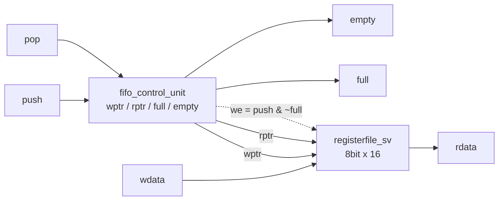
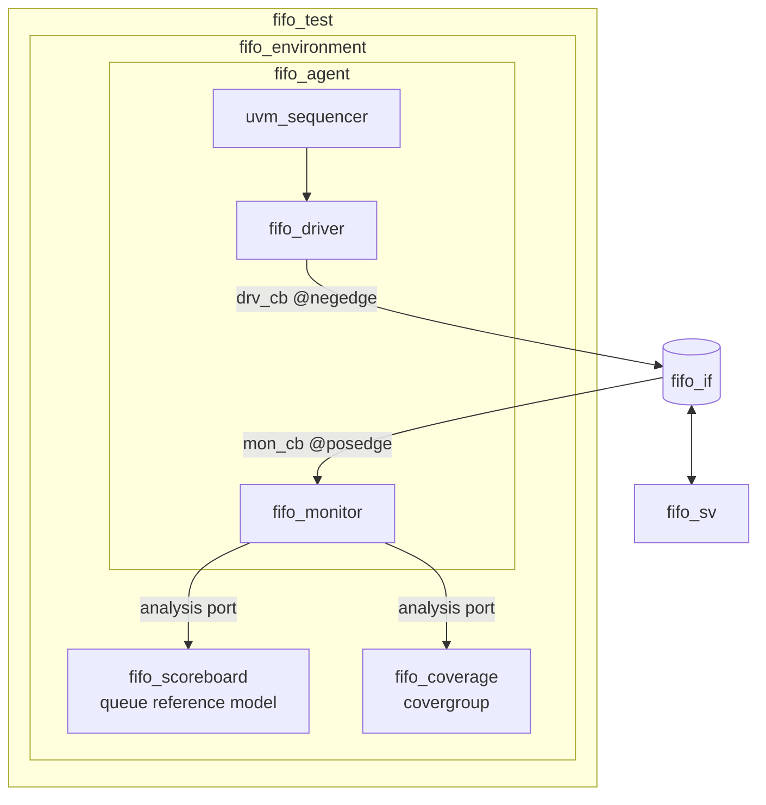

# Synchronous FIFO UVM Verification

SystemVerilog로 설계한 16-entry × 8-bit 동기식 FIFO를 **UVM 1.2** 환경에서 검증한 미니 프로젝트입니다.
Scoreboard(queue 기반 reference model), Functional Coverage(covergroup), SVA, Code Coverage를 함께 사용합니다.

- Simulator : Synopsys VCS W-2024.09-SP1
- Debug / Coverage : Verdi
- Methodology : UVM 1.2 (`-ntb_opts uvm-1.2`)

## Repository Structure

```
.
├── src/
│   └── fifo_sv.sv        # DUT : fifo_sv / fifo_control_unit / registerfile_sv
├── sim/
│   └── tb_fifo_uvm.sv    # interface, UVM components, test, top module
├── .gitignore            # VCS / Verdi output
├── Makefile
└── README.md
```

## DUT : `fifo_sv`

| 항목 | 내용 |
|---|---|
| Depth × Width | 16 × 8bit (`WIDTH = 4` → `2**WIDTH` entries) |
| Reset | 동기식 active-low (`rst_n`) |
| Read 방식 | FWFT (First-Word Fall-Through) — `rdata = mem[rptr]` 조합 출력 |
| Flag | `full` / `empty` 를 레지스터로 별도 관리 (포인터 MSB 확장 방식 아님) |



### 동작 규칙

| push | pop | 상태 | 동작 |
|:-:|:-:|---|---|
| 0 | 0 | - | 유지 |
| 1 | 0 | !full | write, `wptr++`, 다음 wptr == rptr 이면 full |
| 0 | 1 | !empty | read, `rptr++`, wptr == 다음 rptr 이면 empty |
| 1 | 1 | full | pop 만 수행 (write 차단) |
| 1 | 1 | empty | push 만 수행 |
| 1 | 1 | 그 외 | push / pop 동시 수행, 개수 유지 |

## Testbench Architecture



| Component | 역할 |
|---|---|
| `fifo_seq_item` | push / pop / wdata / rst_n (rand) + rdata / full / empty (observed). op 분포 push:pop:both:idle = 4:4:1:1, rst_n=0 확률 2% |
| `fifo_driver` | `drv_cb` 로 negedge + 1ns 에 신호 인가 |
| `fifo_monitor` | `mon_cb` 로 posedge 직전(#1step) 값을 샘플해 analysis port 로 전송 |
| `fifo_scoreboard` | `bit [7:0] q[$]` 기반 reference model 로 full / empty / rdata 비교 |
| `fifo_coverage` | `uvm_subscriber`, op × full × empty cross 및 wdata / rdata 값 coverage |
| `fifo_if` | clocking block + SVA (`full && empty` 동시 발생 금지) |

### Driver / Monitor Timing

드라이버와 모니터의 샘플 시점을 반 주기 떨어뜨려 DUT 와의 race 를 제거했습니다.

```
            posedge          negedge   +1ns          posedge
clk     ____/‾‾‾‾‾‾‾‾‾‾‾‾‾‾‾‾\_________________________/‾‾‾‾
                                        ↓ drive (drv_cb, output #1)
push/pop/wdata ═══ item N ══════════════╳═══ item N+1 ═══════════
                                                     ↑ sample (mon_cb, input #1step)
```

- 모니터는 **"이번 엣지에 들어갈 명령 + 엣지 이전 DUT 상태(full / empty / rdata)"** 를 한 트랜잭션으로 수집합니다.
- 스코어보드는 **비교 → 예측 모델 갱신** 순서로 처리하므로 DUT 의 *현재 상태 + 입력 → 다음 상태* 와 동일한 순서가 됩니다.
- 같은 posedge 에서 drive 와 sample 을 함께 하면 모니터가 갱신 전/후 값을 섞어 읽어 스코어보드가 한 사이클 어긋날 수 있습니다.

## Verification Plan

### Test Scenario (`fifo_test`)

| # | Sequence | 횟수 | 검증 목적 |
|:-:|---|---|---|
| 1 | `fifo_reset_sequence` | 5 | 초기화, reset 후 empty=1 / full=0 |
| 2 | `fifo_full_sequence` → `fifo_concurrent_sequence` | 2×DEPTH → 5 | full 도달, overflow 차단, full 상태 동시 push/pop |
| 3 | `fifo_empty_sequence` → `fifo_concurrent_sequence` | 2×DEPTH → 5 | empty 도달, underflow 차단, empty 상태 동시 push/pop |
| 4 | `fifo_full_sequence` → `fifo_reset_sequence` | 2×DEPTH → 5 | 데이터가 찬 상태에서 reset (working reset) |
| 5 | `fifo_normal_sequence` | 5000 | constrained random (중간 reset 포함) |

### Checkers

| 대상 | 방법 |
|---|---|
| `full`, `empty` | scoreboard reference model 과 매 사이클 비교 |
| `rdata` | FIFO 가 비어있지 않을 때 queue head 와 비교 (FWFT) |
| `full && empty` 동시 발생 | SVA `A_FULL_EMPTY_EXCLUSIVE` |
| reset 사이클 | 비교 생략 후 reference model 초기화 |

### Functional Coverage (`fifo_cg`)

| Coverpoint | Bins |
|---|---|
| `cp_op` | idle / push_only / pop_only / concurrent |
| `cp_full`, `cp_empty` | 0, 1 |
| `cp_wdata` | 0 ~ 255 (유효 push 시) |
| `cp_rdata` | 0 ~ 255 (유효 pop 시) |
| `cx_op_state` | `cp_op × cp_full × cp_empty` (full && empty 는 ignore) |

Code coverage : line / cond / fsm / toggle / branch / assert

## How to Run

VCS, Verdi 환경 변수(`VCS_HOME`, `VERDI_HOME`)가 설정된 Linux 서버 기준입니다.

```bash
make            # compile + sim
make compile    # VCS compile (coverage, FSDB 포함)
make sim        # simulation → sim.log
make verdi      # 파형 확인 (wave.fsdb)
make cov        # Verdi coverage GUI
make urg        # 텍스트 coverage 리포트 → urgReport/
make clean
```

옵션:

```bash
make sim VERBOSITY=UVM_LOW     # 로그 줄이기 (기본 UVM_HIGH)
make compile FSDB=0            # 파형 덤프 끄기
```

## Results

> 시뮬레이션 후 `sim.log` 의 report_phase 출력과 `urgReport` 결과로 채워주세요.

| 항목 | 결과 |
|---|---|
| Flag Pass / Fail | |
| Data Pass / Fail | |
| UVM_ERROR / UVM_FATAL | |
| Functional coverage (overall / cx_op_state) | |
| Code coverage (line / branch / toggle) | |

## Known Limitations / TODO

- 드라이버는 아이템이 없을 때 신호를 idle 로 되돌리지 않아, 시퀀스 사이와 테스트 종료 직전에는 마지막 push/pop 값이 유지됩니다. 모니터가 실제 핀 값을 보므로 검증 결과에는 영향이 없습니다.
- coverage 는 reset 사이클도 샘플하므로 일부 cross bin(예: idle + full)이 reset 시퀀스로 채워질 수 있습니다.
- full 상태에서 push 와 pop 이 동시에 오면 write 가 차단됩니다 (설계상 선택).
- 데이터 폭 8bit 가 고정되어 있습니다 (`DATA_WIDTH` 파라미터화 예정).
